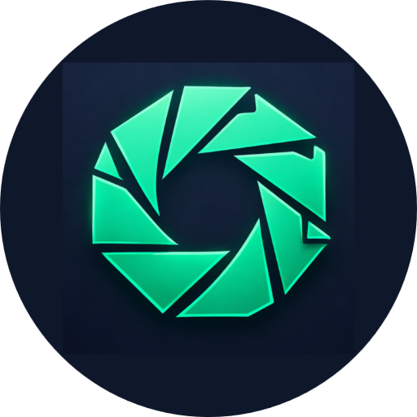

# ✒️ Sahifah Lens (العدسة)

> **Private. Local. Sovereign.**
> A high-performance, local-first document scanner and vault. No accounts, no ads, no cloud.

<div align="center">
<a href="https://lens.open-waqf.org">

</a>
</div>

Sahifah Lens allows users to digitize documents, perform OCR, and organize their personal library directly on their
device. Built on the principle of **Amanah** (Trust), it ensures that your sensitive documents never leave your physical
control. Read our [Local Privacy Policy](PRIVACY_POLICY.md).

---

## 🌟 Key Features

### 🛡️ Privacy & Sovereignty

* **Zero-Cloud Architecture:** Documents stay in the app's private storage on the phone (Android app), or in the
  browser's private storage (OPFS and IndexedDB) on the web. Nothing is uploaded; every test fails if the app tries to
  reach the network.
* **App Lock (Android):** Optional fingerprint or face unlock (Android's own biometric prompt) when the app opens and
  when it comes back from the background.
* **Clipboard Auto-Clear (Opt-in):** Clears app-copied text from clipboard after 60 seconds.
* **Stream-Encrypted Backups:** Export your library as a `.slbk` vault using AES-256-GCM with a chunked streaming
  protocol (Magic: `SLBK`).
* **Advanced Mirror Folder (Optional):** Save an extra encrypted `.slbk` copy to a user-chosen local folder after export.
* **Nuclear Reset:** A "Reset Storage" kill-switch erases all local documents and database entries instantly.
* **Inclusive Design:** Optimized for screen readers with semantic labels and high-contrast controls.
* **Offline First:** Fully functional in airplane mode; OCR and image processing are 100% local.

### 📸 Intelligent Scanning & Editing

* **Quick Scan (Android):** Google's document scanner (ML Kit, part of Google Play services) finds the page edges and
  straightens the page. It runs on the phone; it needs Google Play services on the phone.
* **Camera Scan (web):** In the browser, a live camera view with edge detection in a Web Worker.
* **Import:** Photos, images and PDFs from the phone or computer.
* **Visual Filter Picker:** Real-time thumbnail previews for Magic Color, B&W, and Whiteboard filters.
* **Quality Presets:** `Archive`, `Share`, and `Original` output policies balance readability, file size, and processing cost. `Original` disables auto-sharpening.
* **Thumb Encoding Policy:** Library/editor thumbnails are encoded as WebP for smaller storage while master pages remain JPEG for compatibility.
* **The "Stitcher":** Merge multiple separate scans into a single organized document.
* **Perspective Correction:** Automatically warps and crops images to fix camera angles.

### 🔍 Deep Search & OCR

* **On-Device OCR:** Uses **Tesseract.js** in WebWorkers to extract text without internet.
* **Arabic PDF Robustness:** Arabic OCR text layers require the bundled `public/fonts/noto-arabic.ttf` font; export fails fast if that asset is missing.
* **Contextual Snippets:** Search results highlight the exact sentence found in OCR text or user notes.
* **Rich Metadata:** Organize with Folders, Tags, and private searchable Notes.
* **PDF Generation:** Compile professional, searchable PDFs with invisible text layers locally.

---

## 🏗️ Technical Architecture

* **UI:** TypeScript + Lit (Web Components) + Tailwind CSS.
* **Persistence:** Dexie.js (IndexedDB) for metadata; page images in the app's private files on Android, OPFS on the web.
* **Crypto:** Web Crypto API using PBKDF2-SHA-256 (`600,000` iterations, `16-byte` random salt) and AES-256-GCM
  (`12-byte` random IV per encrypted chunk).
* **Native:** Capacitor 8 (Android): document scanner, biometric lock, files and the system share sheet.
* **Sensory:** Hybrid Haptic engine for tactile feedback on both Web and Native.
* **Localization:** Single-file registry in `src/lib/i18n.ts` (locale config + all messages + text direction).

### 🌍 Localization Workflow

To add or update a language, edit only `src/lib/i18n.ts`:
- add messages in the locale registry
- set locale metadata (`label`, `dir`)
- `dir` supports both `ltr` and `rtl`; app root direction is applied automatically via `document.documentElement.dir`
- current shipped locales: `en` and `ar` (Arabic RTL)
- all user-visible labels, placeholders, hints, and ARIA text must use translation keys (no hardcoded UI strings)

### ♿ Accessibility i18n Rule

- Every interactive control must have an accessible name (`aria-label` or visible label) sourced from i18n keys.
- New UI controls should be tested in both `en` and `ar` to verify label readability and direction-aware alignment.

---

## 📱 Minimum Platform Targets

* **Android:** Android 11 (API 30) or newer. Tested on a moto g75 5G (Android 16). Quick Scan needs Google Play
  services.
* **Web/PWA:** current Chrome, Firefox and Safari (OPFS required).
* **iOS:** not built yet.

These are product support targets for release validation (performance and compatibility gates), not a guarantee of
identical performance on all hardware tiers.

---

## 🛠️ Developer Setup

Node 22 or newer (`.nvmrc`), JDK 21 and the Android SDK for the phone build.

```bash
npm ci
npm run dev            # http://localhost:5173
npm run check          # before every commit: typecheck, translations, unit and browser tests
```

| Command | What it does |
|---|---|
| `npm run check -- --desktop --build` | the full check GitHub runs: all screens, against the production build |
| `npm run android:run` | build and install the **Lens Dev** test app on your USB phone (own id, next to the Play Store app) |
| `npm run android:live` | Lens Dev loads from this computer and reloads on every save |
| `npm run test:android` | phone tests on the USB phone (see [docs/TESTING.md](docs/TESTING.md)) |
| `npm run release -- --dry-run` | show what a release would do; without `--dry-run` it releases (website + Android bundle) |
| `npm run android:release` | only the signed Android bundle for Play Console (unlock the key vault first) |

How the tests work: [docs/TESTING.md](docs/TESTING.md). Upgrading packages:
[docs/DEPENDENCIES.md](docs/DEPENDENCIES.md). Timing gates: [docs/perf.md](docs/perf.md).

GitHub runs the checks on every push and pull request into `develop`, and deploys
lens.open-waqf.org only from a version tag (made by `npm run release`).

---

## ⚠️ Disclaimers

* **Storage Persistence:**
* **Native App (APK):** Binary files are stored in persistent app-internal storage. Metadata still depends on WebView IndexedDB.
* **Web/PWA:** Managed by the browser. The OS may clear this if storage is low.
* **Recommendation:** Always export an **Encrypted Backup** to secure your data permanently.
* **Storage Cleanup Signal:** If file cleanup partially fails (for example due filesystem/browser restrictions), the app
  surfaces a Storage Cleanup banner that directs you to run **Settings -> Storage Audit**.

* **Vault Format:** `.slbk` header spec is documented in [VAULT_SPEC.md](VAULT_SPEC.md). You can inspect an exported
  backup without decrypting via:

```bash
node scripts/slbk-verify.mjs ./lens-backup-YYYY-MM-DD.slbk
```


* **Sovereignty:** You are responsible for your own keys/passwords. There is no "Forgot Password" link because there is
  no server.
* **App Lock Scope:** Biometric/app lock is a local UX gate for shoulder-surfing/device access friction. It is not the
  cryptographic security boundary; vault backup encryption (`.slbk`) is enforced separately via PBKDF2 + AES-GCM.

<div align="center">
<p><em>Built with ❤️ for the Ummah and Humanity.</em></p>
<p><small>Released under <a href="https://www.elastic.co/licensing/elastic-license">Elastic License 2.0 (ELv2)</a> — free for personal, professional, and institutional use. Hosting as a competing managed service is not permitted.</small></p>
</div>
